# Fascicolo 23

A detective game for Windows, in Italian, that I made as a birthday present, for fun. The title means "case file no. 23".

## Stack

- TypeScript and Vite, with no UI framework
- Electron, packaged by electron-builder as a single portable `Fascicolo23.exe`
- Every illustration written as SVG code, with no image files
- Fonts from `@fontsource`, chess.js for the chess problem
- Vitest for the logic: the mate in three, the single liar, the clue graph
- Playwright, which plays the whole game offline in every valid room order and takes screenshots at three resolutions

All player-facing text lives in `content/content.json`.

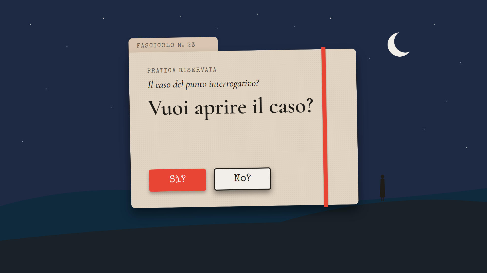

## The case

You open *Il caso del punto interrogativo*, the question mark case. A cork board holds five rooms, and two of them start open. Solve a room and you get a piece of a YouTube link plus a clue or two. You need those clues to open the other rooms. In Room 46 you accuse the culprit, the link completes and the video opens in the browser.

A silhouette called the Witness follows you through every room and ends every sentence with a question mark. The buttons do it too: *Sì?*, *No?*, *Entra?*.

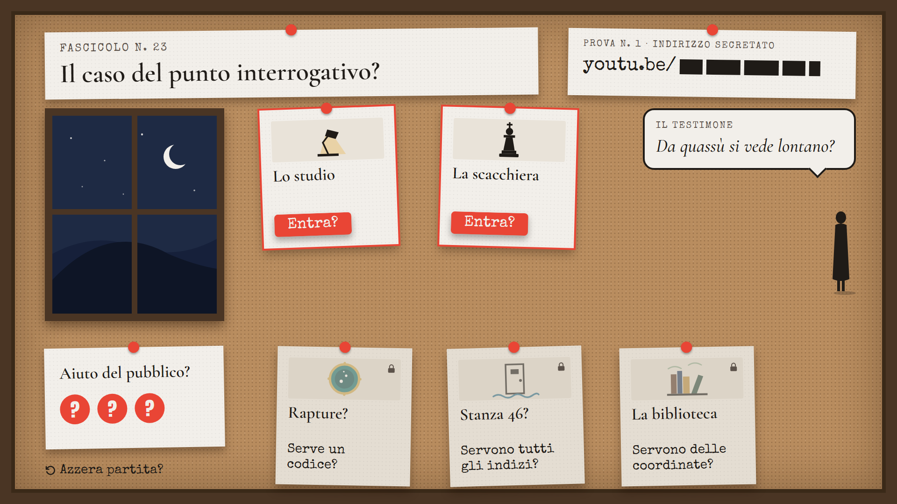

## The rooms

**The study.** You read three witness statements and pick the psychology effect behind each one, such as weapon focus or question wording.

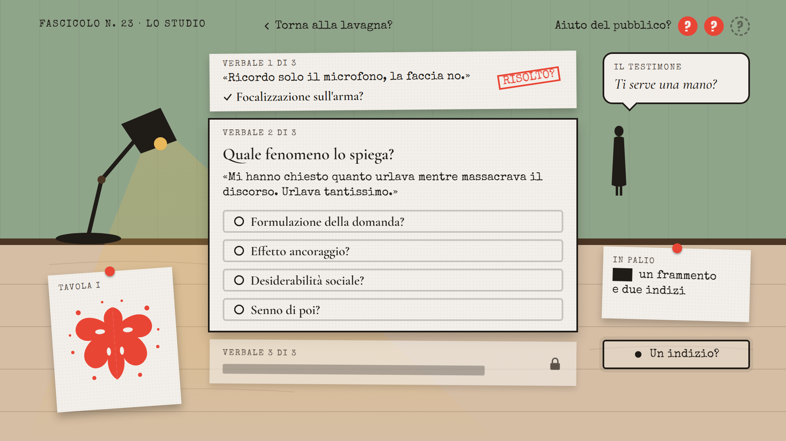

**The chessboard.** You play a mate in three as White. It ends with Kg4, and g4 tells you where to look in the library.

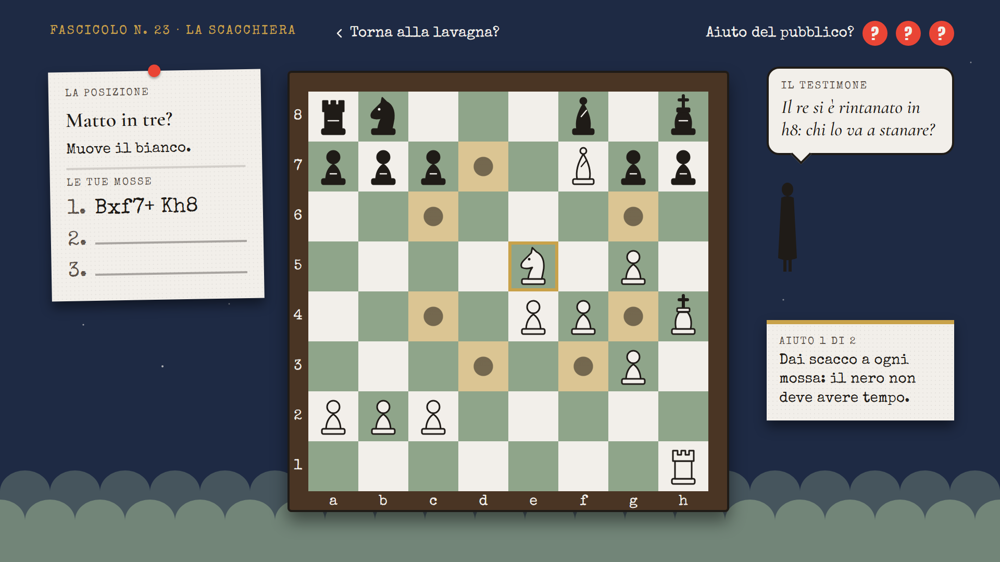

**The library.** An 8x8 shelf of books. Behind one of them you find a small mystery: somebody cut down a hedge in the night, and three witnesses give you times. One of them always lies. Find the liar and you get the time of the crime, 04:51.

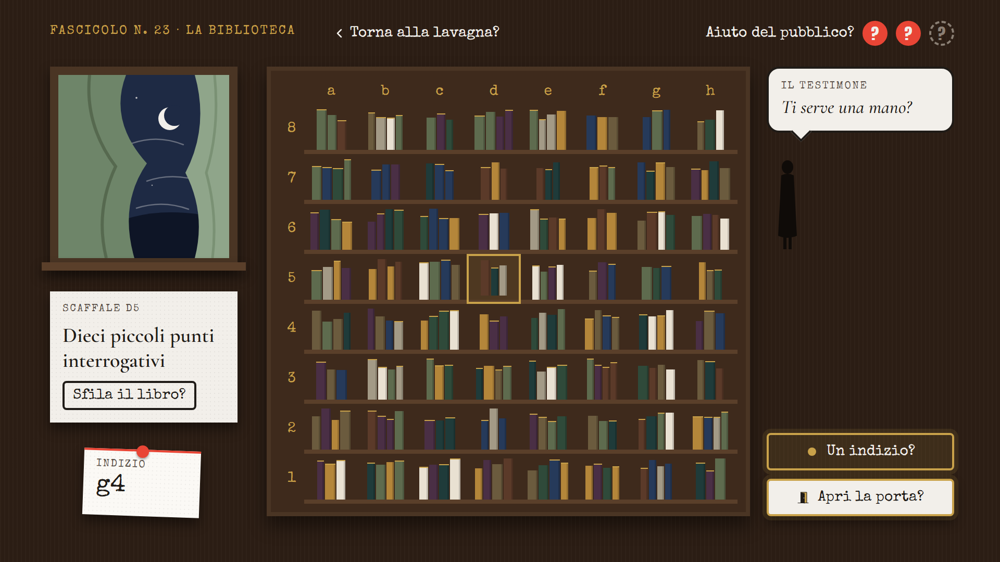

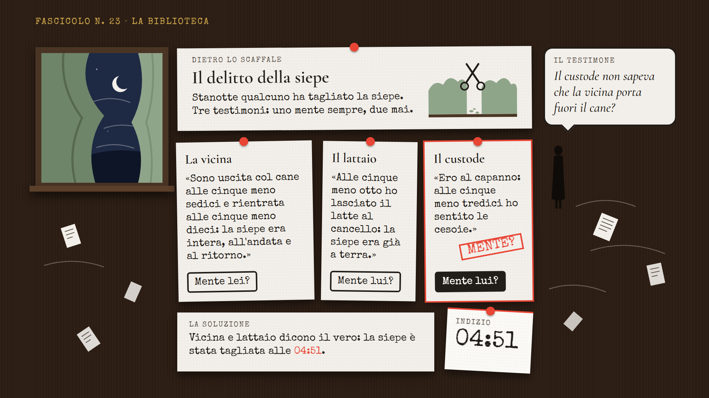

**Rapture.** An art deco door under the sea, with a keypad. The code is the library time, 0451. Inside, voices shout orders at you. Obey the ones phrased as a question and ignore the rest: that's the rule from the study. "Would you kindly" doesn't count.

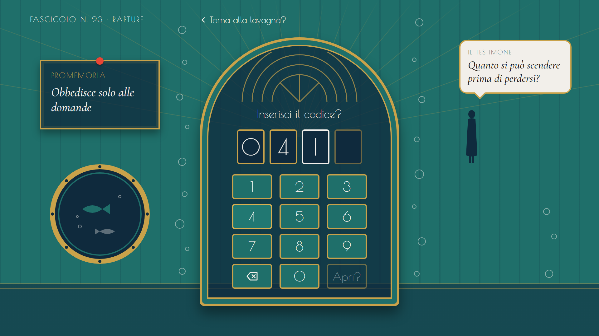

Every solved room ends on a five-star scene with the fragment you won.

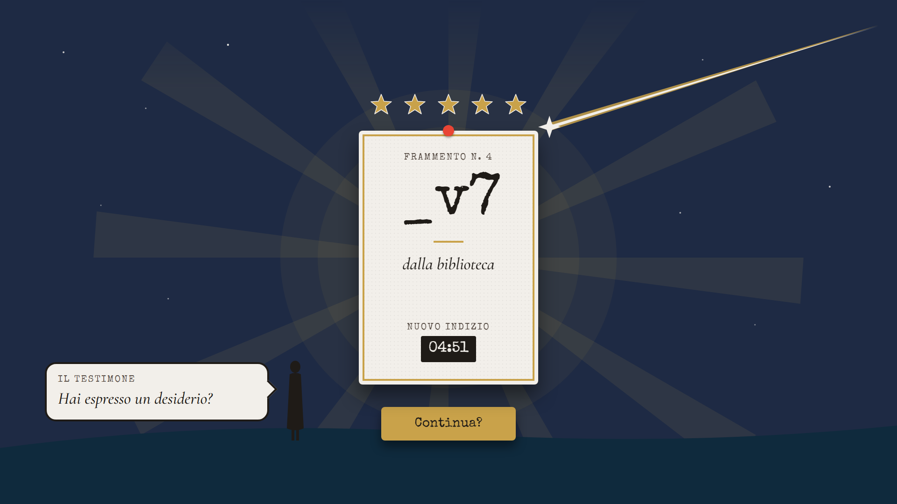

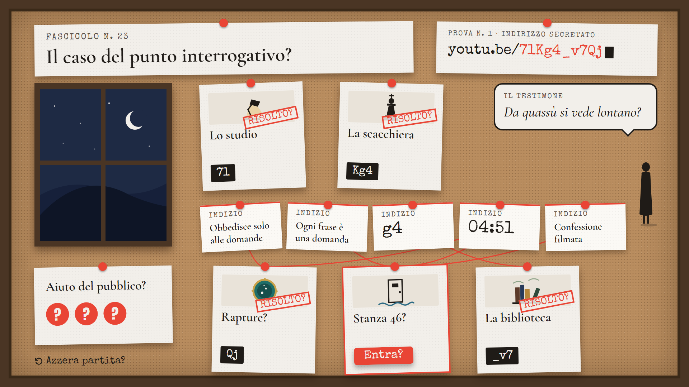

**Room 46.** Four suspects: the Gardener, the Literature Professor, the Boyfriend and the TV Diva. You pin each clue on the suspects it fits, then drag the red string onto the culprit. A wrong accusation costs you nothing.

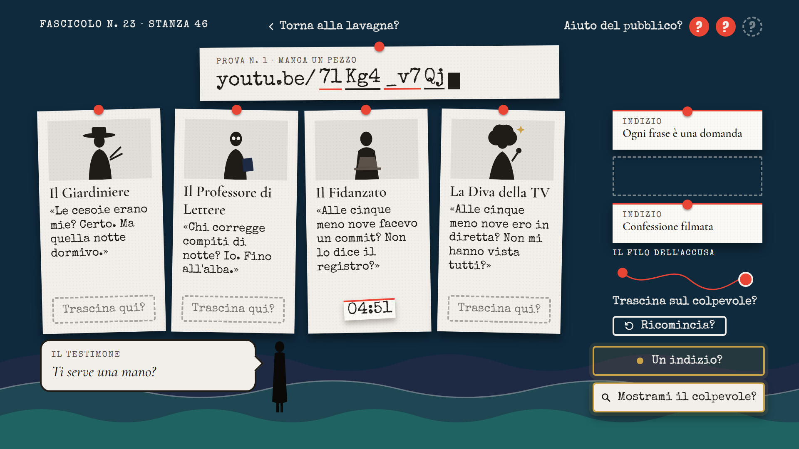

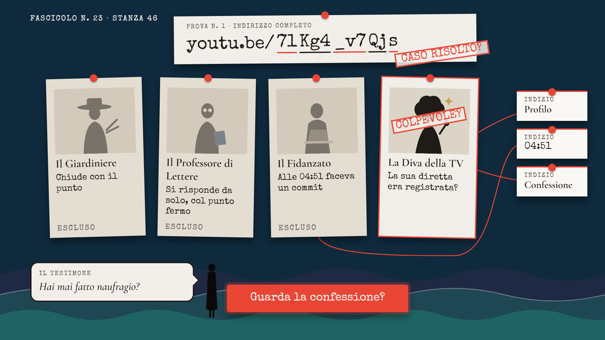

After the video, the Witness asks one last question, *Il tuo regalo è oltre la siepe?* ("is your present beyond the hedge?"), and sends you to the real present: a poster.

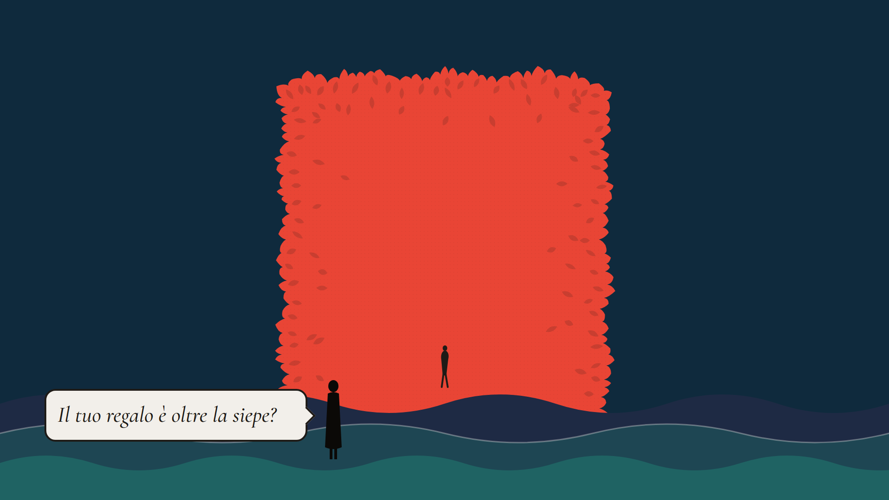

## Nods

Rapture borrows from BioShock, Room 46 from Blue Prince, and the five-star scene from the wishes in Genshin Impact. Every illustration is SVG code, and the game uses no images, music or logos from those games.

## Built for a live audience

- **Audience help.** The audience gets three tokens per game. Each token gives the people watching 30 seconds to shout the answer. Rapture has no audience help.
- **Nobody gets stuck.** After two minutes or three mistakes, a hint button appears. After five minutes you can solve the room with *Apri la porta?*. Every room has its own thresholds in `content/content.json`.
- **Host keys**, hidden from the screen: Ctrl+Shift+N solves the room, Ctrl+Shift+H gives a hint, Ctrl+Shift+G returns an audience token, Ctrl+Shift+D opens a debug menu, Ctrl+Shift+R resets the game.
- **Saves.** The game saves after every room and picks up where it left off on launch.
- **Offline.** The .exe carries every font, sound and drawing. The game makes one network request, for the video at the end.

## Run it

```sh
npm install
npm run dev                       # play in the browser
npm test                          # unit tests
npx playwright install chromium   # once, before the e2e tests
npm run e2e                       # full playthrough
npm run dist                      # release/Fascicolo23.exe, on Windows
```
